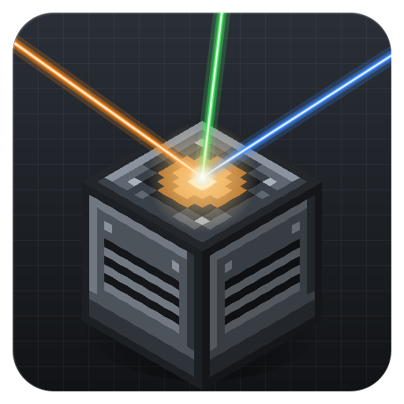

# Laser Assembly



A laser workshop for NeoForge: an assembly table fed by lasers. Fit a laser with a lens and its
beam cuts, welds or engraves; some recipes go through steps, each asking for its own beam. Push the
intensity too hard and the table heats up, slows down, then stops — build cooling around it.

The spirit of BuildCraft's Assembly Table, redesigned rather than copied.

**Download:** [CurseForge](https://www.curseforge.com/minecraft/mc-mods/laserassembly)

## How it plays

- **The table takes no power.** Lasers bring it: point one or more at the table, within range and
  line of sight, and feed them Forge Energy from any mod that makes it.
- **Lenses give the beam its type**: cutting, welding, engraving. A laser with no lens fires a raw
  beam, which works on any step at a tenth of the speed, or not at all if the server says so.
- **Recipes in steps.** Most recipes take any beam. Some go through up to three steps in order, a
  trident cut then welded. The lasers whose lens fits the current step fire; the others hold.
- **Intensity, per laser.** Each beam is judged on its own against the step: too weak and it does
  nothing, past a threshold it heats the table, past a maximum it overloads. More lasers go faster,
  each counting for 70 % of the one before.
- **Heat.** It slows the table past half, stops it at the top, and leaves on its own. Water and ice
  around the table take it away faster.
- **Augments** in the laser: Regulator (sets its own intensity), Barrel (three more lenses, fired
  step by step), Range, Efficiency.
- **One screen for the table**: pick the recipes it may run, see the step and its progress, and in
  side tabs set every linked laser's intensity, each face's automation, and its redstone control.
- **Automation**: per-face input and output, auto import and export, a comparator signal.
- **Recipes for vanilla items survival cannot get** — saddle, trident, chainmail, name tag, horse
  armour — in a built-in datapack you can turn off.

## For pack makers

Recipes, beam types, augments and coolants are all datapack content. A beam type names its lens
item and its colour; an augment names its item and its effects; a coolant names its blocks and how
much it cools. Each lens and augment is its own item, so tags, KubeJS, CraftTweaker and JEI see
plain item ids. A recipe:

```json
{
  "type": "laserassembly:assembling",
  "ingredients": [
    { "ingredient": { "item": "minecraft:iron_ingot" }, "count": 3 },
    { "ingredient": { "item": "minecraft:prismarine_shard" }, "count": 4 }
  ],
  "result": { "id": "minecraft:trident" },
  "steps": [
    { "beam": "laserassembly:cut", "energy": 4000 },
    { "beam": "laserassembly:weld", "energy": 6000 }
  ]
}
```

The server config sets the rest: intensity thresholds, raw beam factor, stacking, heat, range.
Every field and setting is in the [datapack reference](docs/DATAPACKS.md).

**Optional companions:** [JEI](https://www.curseforge.com/minecraft/mc-mods/jei) shows every recipe
with the lens each step needs; [Jade](https://www.curseforge.com/minecraft/mc-mods/jade) shows what
a table is making, its step and its heat.

## Building

```
gradlew build
```

The jar lands in `build/libs/`. `gradlew runGameTestServer` runs the in-world tests,
`gradlew test` the unit tests. The design and the reasons behind it are in
[DESIGN.md](DESIGN.md) (French).

## Permissions

**Modpacks: yes.** No permission needed, no message required, public or private, monetised or not,
on any platform or launcher. If you are reading this to find out whether you may include
Laser Assembly, the answer is yes and you can stop reading.

**Credit** is appreciated and never required.

**Forks and addons: yes**, under the MIT terms. Please do not publish a fork under the name
*Laser Assembly* — the name is not covered by the licence, and two projects sharing one name only
confuses the people trying to work out which one broke.

**Assets** — artwork, icons, logo — are the one exception: redistribute them with the project
freely, but do not lift them into another project. See [LICENSE-ASSETS](LICENSE-ASSETS).

**Contributions** are accepted under the same terms as the rest of the repository.
